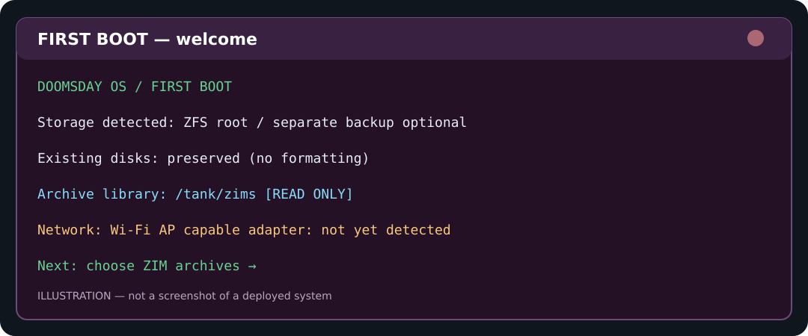
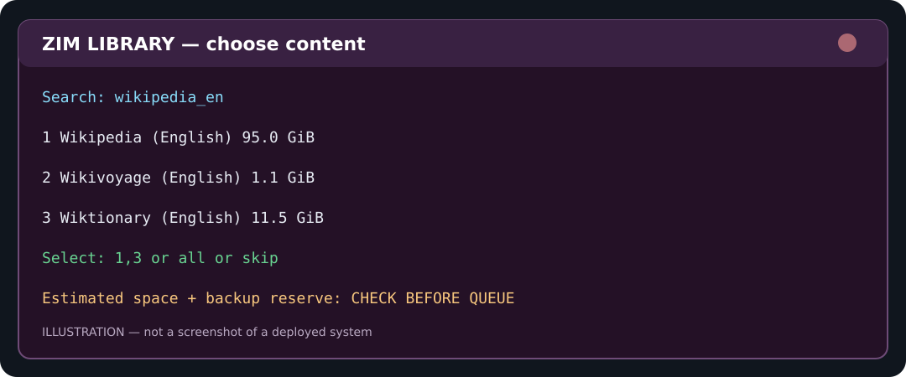
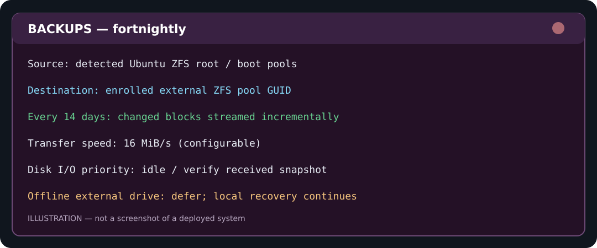

# Doomsday Vault First-Boot V6 — portable, offline and preservation-oriented

**Status: prototype / reference implementation.** Python unit tests and shell syntax checks have passed. No actual Ubuntu Desktop ISO, ZFS import/export cycle, multi-machine boot, or real ZIM download has been tested in this environment. Do **not** consider this a proven disaster-recovery system until you have restored a complete test system onto a spare disk.

This package upgrades V4 with a long-term archive policy, a root-safe read-only ZFS dataset, direct ZFS streaming to an enrolled backup drive, and a read-only portability report. It carries the standalone Recovery V2 package as a dependency. Nothing formats or partitions an unknown disk. The ISO builder is experimental; it requires a separate official Ubuntu Desktop ISO (not supplied).

## What survives a computer or port change?

The installed Ubuntu instance and its ZFS pools retain metadata, snapshots and local files when moved to another compatible x86_64 computer. USB device names (`/dev/sda`, `/dev/sdb`) can change; the recovery component uses ZFS pool GUIDs and matches the enrolled backup's dataset. A hardware scan checks idle, AP-capable Wi-Fi devices and will not steal an active wireless connection. **There is no guarantee of booting on every machine:** UEFI boot restrictions, Secure Boot keys, missing storage controller drivers and insufficient RAM can still block boot. Run the read-only report before a physical move.

## Backup design and limitations

| Current drives | Behavior |
|---|---|
| Only system drive | Local snapshots and Recovery V2 local system editions, with `copies=2` for newly written recovery data and selected system datasets |
| System drive plus **enrolled separate ZFS backup pool** | Same local protection, plus fortnightly direct ZFS `send`/`receive` streaming of all selected system filesystems; independent EFI TAR and disk-layout metadata are also saved if the FAT32 EFI partition is actually mounted |
| Data drive not connected | External streaming skips; local snapshots and recovery operate normally |
| New, unknown USB drive | Not formatted, enrolled, imported by force, or overwritten |

A **single drive cannot back up its own physical existence**. ZFS snapshots and `copies=2` can fix limited corruption; if the disk's electronics or platters fail, both can be lost. The external backups must be on a physically different device. A 500 GB system drive cannot necessarily store every ZIM from a populated 1 TB drive, so users select important ZIMs for secondary backups. Source, backups and EFI files are not silently rolled back following an arbitrary error.

Recovery V2's local editions are file-based compressed ZFS streams; they involve disk reads and writes. For the **external drive**, V6 additionally uses `zfs send | zfs receive` without intermediate full archive files. ZFS verifies incoming streams. Interrupted receives use ZFS resume tokens when supported. V6 disables Recovery V2's duplicate external-copy timer to avoid sending identical data twice. Native incremental backup snapshots are capped at the newest three successful common snapshots. V6's streaming tool covers ZFS filesystems in the detected root/boot pools, excluding local recovery and active ZIM staging; it does not cover unrelated mounted filesystems or zvols; ZIM archive datasets are intentionally excluded from system streams and handled by per-archive choices. EFI, recovery partition layout and Secure Boot settings may need separate attention during a bare-metal restore.

## Immutable ZIM design

**A verified ZIM archive is made read-only at the ZFS dataset level.** This is stronger than simply running `chmod 444` on a file, but it is **not protection against bit rot, malware running as root, or entire-disk failure**.

* `*/zims` — dedicated ZFS archive dataset (`readonly=on`); no partial HTTP downloads; Kiwix reads from here.
* `*/zim-staging` — separate writable ZFS dataset for resumable `.part` files; it can be cleared without touching published archives.
* ZIM selection (individual, filtered, or all catalog results) calculates peak staging-plus-final storage requirements, including the ZFS `copies` overhead and a free-space reserve. Unknown-sized archives cannot be queued through "all" without further inspection.
* Final download SHA-256 is checked against the publisher's sidecar checksum before publishing. The file is copied to a temporary name inside the library, checked again, atomically renamed, and the **library is immediately set back to read-only**. A root-only `flock` protects the short publication window. The verified checksum is saved in `/var/lib/doomsday-vault/zim-manifest.json`.
* Every verified publish takes a ZFS snapshot. A monthly `doomsday-zim-verify.timer` rereads whole ZIMs in idle-I/O mode and compares SHA-256 values. Publisher hashes prove matching bytes, not cryptographic provenance or trustworthy medical content.
* If a verified archive becomes corrupted, ZFS scrubbing and `copies=2` can sometimes transparently repair blocks. **Optional** `auto_restore_verified_zims` permits an archive-only restore from an independently mounted ZFS pool, **only when the backup hashes to the trusted SHA-256**, and it quarantines the damaged version. It never automatically rolls back Ubuntu. If the backup isn't healthy or lacks space, it reports an error without destroying the original.
* Use `zimcheck` as a separate archive-structure check if installed. This complements SHA-256; it is not automatically run by this starter.

`copies=2` is configured for a **new** dedicated ZIM dataset; existing ZIM datasets retain their inherited `copies` setting. Copies are not retroactive: existing data is unaffected. Two copies of compressed ZIM data may consume approximately twice the disk space. If you want to keep an entire large library and cannot afford `copies=2`, use a separate disk replica instead. The system **never silently changes `copies=2` to `copies=1`**.

A power outage while publishing can leave a hidden `.publishing-*.zim` file, and the boot service will reassert readonly. This is deliberate fail-safe behavior: inspect and clean the orphaned staging file manually rather than overwriting it. An interrupted download in the staging dataset is resumed using HTTP ranges when supported; final SHA-256 is always checked.

## Install on an existing Ubuntu Desktop with ZFS

Before running this on an important vault, make a recovery backup and verify you can boot and import the current pools. Existing V4 `*.zim.part` files in the main ZIM dataset must be migrated or removed **manually** before enabling immutable mode. No device formatting is performed by these scripts.

All commands below are **single-line**, ready to paste into a terminal.

1. Download `doomsday-firstboot-v6.zip` into `~/Downloads`.
2. Extract: `cd ~/Downloads && unzip doomsday-firstboot-v6.zip`
3. Install: `cd ~/Downloads/doomsday-firstboot-v6 && sudo ./install.sh`
4. Run configuration wizard (ZIM selection and optional AP-capable Wi-Fi hotspot): `sudo doomsday-setup`
5. Check ZIM archive state: `sudo python3 /opt/doomsday-firstboot/app/archive_guard.py status`
6. Check recovery system: `sudo /usr/local/lib/doomsday-vault/status.sh`
7. View auto-start timers: `systemctl list-timers --all 'doomsday-*.timer'`
8. Check portability: `sudo /opt/doomsday-firstboot/scripts/portability-report.sh`

The installer requires Internet access for downloading missing Ubuntu packages, unless they're already installed. It does not download an AI model. Kiwix runs on the local network when it has at least one verified ZIM file. The separate Doomsday Search web UI is **not bundled in V6** and must be installed later. The native Kiwix service is configured to listen on port `8080` of trusted network interfaces; do not expose it directly to the public Internet.

If your existing second drive has a ZFS dataset `tank/zims` mounted at `/tank/zims`, V6 uses it and creates `/tank/zim-staging`. If there is no such dedicated pool, it creates `DOOMSDAY_ZIMS` and `DOOMSDAY_ZIM_STAGING` child datasets on the *detected system pool* at `/srv/doomsday-zims` and `/srv/doomsday-zim-staging`. It does not automatically migrate archives between drives. Root/boot pools are **never made read-only** by the archive guard.

### Enroll any manufacturer's already-prepared backup disk

`sudo /usr/local/lib/doomsday-vault/enroll-external.sh tank/backups` is an **example**, not a required hardware name. Replace with the existing mounted ZFS backup dataset selected by the user. Enrollment stores its pool GUID and checks that it isn't the system or boot pool. It never formats a new disk. Confirm it is a **different physical drive** before relying on it as a backup destination.

Manually start the native streamed backup: `sudo systemctl start doomsday-stream-replica.service`

Check the service result: `systemctl status doomsday-stream-replica.service --no-pager`

Confirm received datasets and snapshots: `sudo zfs list -r -t filesystem,snapshot tank/backups/dv-replicas` (replace `tank/backups` with your enrolled dataset).

Local recovery editions continue to use Recovery V2's 14-day eligibility timer. Streaming to the external pool is separate, every 14 days when eligible and automatic *after enrollment*. It does **not** imply that the OS can reimage itself while running or recover a physically dead disk without another bootable medium.

### Check ZIM integrity

Force a read-only checksum audit: `sudo python3 /opt/doomsday-firstboot/app/archive_guard.py verify`

Inspect scrub status: `sudo zpool status`

Manual scrub example for an existing pool: `sudo zpool scrub tank` (replace with your verified pool name).

Check the library's actual read-only flag: `sudo zfs get readonly,copies tank/zims` (replace dataset if running on one drive).

### Restore after a failure

* For individual ZIM corruption, verify the independent backup's checksum and recover **only** the affected archive. The optional auto-restorer requires two different mounted ZFS pools and explicit opt-in at setup.
* For ZFS pool corruption, an OpenZFS scrub can repair blocks only when another good redundant copy is present; check `zpool status` first.
* For OS boot failure, boot a trusted recovery environment, import the surviving pools read-only for inspection, and restore from a validated backup to a **spare disk**. You must restore disk layout/EFI boot chain and verify root pool mount settings before rebooting. V6 does **not** automatically overwrite active ZFS roots or EFI partitions on boot.
* After recovery, validate the system and a sample of archived ZIMs. Retain one backup drive offline wherever possible to reduce theft, power, ransomware and correlated-failure risk.

## Hardware switching

Shut down Ubuntu completely before moving its system disk. For a data-only drive, stop applications using it, then `sudo zpool export POOL` before disconnecting. The import helper uses enrolled pool GUIDs and `/dev/disk/by-id`; it does not use `zpool import -f`. The Wi-Fi rechecker runs periodically, starts an SSID only when the user opted in and an *idle* AP-capable interface exists, and doesn't steal an active wireless interface. NetworkManager manages the hotspot's local DHCP. After moving computers, run the portability report. Confirm firmware USB boot, UEFI fallback files, available CPU instructions, and Secure Boot policy. Incompatible firmware or missing drivers still requires human intervention.

## Build an open-source installation ISO (experimental)

`./build-iso.sh /path/to/ubuntu-desktop.iso /path/to/doomsday-desktop.iso` injects this first-boot payload and a sample interactive `autoinstall.yaml` into a **locally supplied** Ubuntu Desktop ISO. `xorriso` must be installed. The script attempts to preserve the base ISO's boot configuration via `-boot_image any replay`.

**A generated ISO is not proven bootable.** Test it in an isolated VM with a disposable virtual disk first. Installers are highly version-dependent; check that the `autoinstall.yaml` is actually recognized and that its late-commands stage `doomsday-bootstrap.service` in the target. The sample installer requires *interactive storage selection* and does not silently erase disks. Test BIOS/UEFI/Secure Boot separately before publicly distributing it.

This kit contains original Python/Bash service code and the MIT-licensed Recovery V2 component. Before redistributing an Ubuntu installer or ZIM archives, check Ubuntu trademark/license policies and each source archive's license and redistribution terms. **No Ubuntu ISO and no ZIM data are bundled here.**

## Verification status

Automated tests cover: archive checksum, refusing to make the running OS root read-only, rejecting corrupt staged files before publishing, restoring the read-only flag after publishing, and URL validation. Shell scripts pass `bash -n`. Real bare-metal and power-interruption tests remain outstanding. Public releases should also undergo static security review and restoration tests. This starter is not a certified medical or safety device.


## V6 — 14-day incremental policy and example screens





These are **illustrative examples**, not actual application screenshots or proof of successful recovery.

* **Install once; run without Downloads.** The installer copies executable code to `/opt/doomsday-firstboot` and Recovery V2 tools to `/usr/local/lib/doomsday-vault`. After a successful installation, removing the extracted `Downloads` folder will not remove installed services. Keep the downloaded ZIP only as an offline installer copy if desired.
* **Fortnightly local recovery.** The Recovery V2 local full-edition backup runs when eligible (default 14 days), under `Nice=19` and `IOSchedulingClass=idle`. These local compressed backups **do read and write the same disk**; a ZFS snapshot is more efficient, but the local edition provides an independent file copy on surviving sectors.
* **Fortnightly incremental external replication.** First success streams the full set of selected system ZFS filesystems. Later runs transmit changed ZFS blocks only, using `zfs send -i`, with `stream_mib_per_second=16` by default and 1 MiB bounded chunks. Backups are only marked successful when an enrolled external drive is mounted. `zfs receive -s` allows interrupted-stream continuation when OpenZFS provides a resume token. The system does **not** overwrite external datasets with `receive -F`.
* **14-day ZIM audits.** SHA-256 revalidation checks existing manifest entries and can perform an **opt-in** restore of an individual damaged ZIM only from an independent, verified backup. ZFS scrub timers are separate and should be checked with `systemctl list-timers 'zfs-scrub*'`.
* **ZIM backups are optional per archive.** Select which ZIMs to replicate at setup after the free-space check. There is no universal guarantee that all ZIMs will fit in both drives. A copy on the same pool is not an independent backup, and neither drive can back up its own complete mechanical failure.
* **The ISO builder is experimental** and requires an official Ubuntu installer ISO. No bootable ISO or AI model is included. **Validate first-boot and restores before adding AI or making public releases.**

### One-line commands after installation

```bash
sudo doomsday-setup
sudo doomsday-zims status
sudo python3 /opt/doomsday-firstboot/app/archive_guard.py status
sudo systemctl start doomsday-stream-replica.service
sudo /usr/local/lib/doomsday-vault/status.sh
systemctl list-timers --all 'doomsday-*.timer'
sudo journalctl -u doomsday-stream-replica.service -n 50 --no-pager
```

### 14-day rate limit

The administrator can change `stream_mib_per_second` in `/etc/doomsday-vault/backup-policy.json`; a value of `0` removes the byte-rate limit. For an HDD, start with 8–16 MiB/s to limit contention. The scheduler checks daily; if the 14-day period has passed but CPU load is too high or the external drive is absent, it defers the job. The next successful run marks the interval. **The fallback does not guarantee an exact 14-day time under indefinite high load or disconnection.**

### What isn't complete

* Automatic full bare-metal rollback on every detected error would be dangerous and is **not enabled**. EFI recovery is captured as verified files but actual EFI repair must be invoked from a recovery environment after diagnosis.
* The backup policy covers system/boot ZFS filesystems and selected ZIM copies; it is not a forensic disk image of every partition or attached drive. Data stored only on an external ZFS pool requires a third independent destination for full-drive failure protection.
* Archive catalog compatibility depends on Kiwix's live feed and SHA-256 sidecars; test the first real download. Mocked tests cannot guarantee publisher endpoints stay unchanged.

## Three first-boot download packages (original ZIM collection)

The **first-boot** `sudo doomsday-setup` wizard and `sudo doomsday-zims wizard` now offer **exactly three download choices**. This is a fixed collection based on the original `Zim(1).zip` torrent list, not a download of the entire Kiwix catalog:

| Choice | Contents | Source archive size (decimal GB) |
|---|---|---:|
| `1` **Full** | All 39 original ZIM archives, including TED Talks | **575.0 GB** (approximately the requested 577 GB) |
| `2` **Partial** | The same original collection **except TED Talks**, with all 38 other ZIMs unchanged | **483.8 GB** |
| `3` **Wikipedia Only** | Only full English Wikipedia (`wikipedia_en_all_maxi_2026-08.zim`) | **127.4 GB** |

**Why Partial isn't ~400 GB:** TED Talks is 91.18 GB in the provided torrent metadata, so 575.0 GB minus 91.18 GB = 483.8 GB. Removing more material to hit 400 GB would contradict keeping the rest of the full collection. These figures exclude ZFS `copies=2` overhead, the largest temporary staging file, free-space reserve and optional independent backups. The installer checks actual disk capacity before enqueueing and will refuse oversized jobs rather than fill the system disk. It never formats a disk to make room.

The bundled manifest contains exact official Kiwix URLs, byte sizes and the 38 SHA-256 hashes supplied alongside the torrents. **One archive (`devdocs_en_python_2026-10.zim`) had no supplied SHA-256 sidecar:** it will require fetching a SHA-256 sidecar from the official server at download time; if unavailable, it is kept for retry rather than installed unverified. Preset contents are frozen at these 2025–2026 archive versions; the files may be removed or moved by their publisher. No large content is bundled in GitHub.

Press **1**, **2** or **3**, review the contents and space estimate, select which ZIMs to back up if a separate drive is enrolled, then type `YES` to queue. The download system uses the existing timer, SHA-256 check, resumable staging, and read-only published library. It does not begin the transfer merely by choosing a number.

To search the broader live Kiwix catalog and choose individual ZIMs, use `sudo doomsday-zims browse`. This keeps per-item selection available without adding a fourth option to the first-boot package menu.

### Upgrade an already-installed V6 / V6.1 without reinstalling or changing ZFS

Run the following one-line command while connected to the Internet (uses both new files from this repository, checks Python and JSON syntax before installing them):

```bash
t="$(mktemp -d)" && curl -fsSL https://raw.githubusercontent.com/TOPG-V/DoomsdayOS/main/app/zim_manager.py -o "$t/zim_manager.py" && curl -fsSL https://raw.githubusercontent.com/TOPG-V/DoomsdayOS/main/app/bundle_manifest.json -o "$t/bundle_manifest.json" && python3 -m py_compile "$t/zim_manager.py" && python3 -m json.tool "$t/bundle_manifest.json" >/dev/null && sudo install -m 0644 "$t/zim_manager.py" /opt/doomsday-firstboot/app/zim_manager.py && sudo install -m 0644 "$t/bundle_manifest.json" /opt/doomsday-firstboot/app/bundle_manifest.json && rm -rf "$t" && sudo doomsday-zims wizard
```

A fresh clone and `sudo ./install.sh` also include the new manifest automatically. Downloaded ZIM files and previously queued entries are not deleted by this update.


## Hotfix 2026-11-09 — Empty ZIM catalog in V6

**Symptom:** After `sudo doomsday-setup`, pressing Enter at the catalog filter prints `No matching downloadable ZIMs`. V6's parser recognized direct `.zim` acquisition links only. Some Kiwix OPDS entries use `.zim.meta4` URLs even when advertising the MIME type `application/x-zim`. This meant supported books were skipped. The hotfix normalizes official `.zim.meta4` acquisition references into direct `.zim` download URLs, improves paginated filtering, and treats `all` as an alias for browsing at the initial title-filter prompt. Selecting *all* downloads is still a separate confirmation and storage-capacity check.

To update **an already installed** V6 without touching ZFS pools, paste this **one line** into Ubuntu Terminal when connected to the Internet:

```bash
f="$(mktemp --suffix=.py)" && curl -fsSL https://raw.githubusercontent.com/TOPG-V/DoomsdayOS/main/app/zim_manager.py -o "$f" && python3 -m py_compile "$f" && sudo install -m 0644 "$f" /opt/doomsday-firstboot/app/zim_manager.py && rm -f "$f" && sudo doomsday-zims wizard
```

When you reach `Search titles`, press Enter to browse up to the first 100 ZIMs, or type a keyword such as `Wikipedia`. Then pick the listed numbers or type `all` at the **selection** prompt. No download begins before the explicit `YES` confirmation. The hotfix is locally tested against synthetic OPDS samples, but a successful live catalog fetch still depends on network and Kiwix endpoint availability.

## V6.3 — clear storage estimates and optional ZIM-only space-saving mode

The three download presets remain **Full** (575.0 GB, 39 archives), **Partial** (483.8 GB, 38 archives; only TED Talks removed), and **Wikipedia Only** (127.4 GB, one archive). This is the *download payload*, **not** required disk capacity.

For the Full preset, the V6 preservation default of ZFS `copies=2` requires about 1,071 GiB for the final archives alone. The largest source archive (Gutenberg, 221.25 GB) needs up to another 412 GiB of two-copy staging while being verified and published. Including the 3 GiB reserve gives approximately **1,486 GiB of peak pool usage (1.60 TB)**. This is why a VM with 888 GiB of free pool space refuses to queue Full.

**New behavior:** The wizard prints actual download bytes, archive duplication, temporary staging, peak capacity, and free capacity separately. If two-copy storage does not fit but single-copy storage does, the wizard optionally offers **SINGLE COPY** mode. It requires the literal `SINGLE COPY` consent and the usual final `YES`. Unless BOTH are provided, no ZFS copies property is changed and nothing is queued. It validates the two mounted dedicated datasets and explicitly refuses to alter the running OS root, boot datasets, or pool roots. Existing blocks are **not** converted; `copies=1` affects only newly written data.

For Full, `copies=1` on the dedicated archive and staging datasets lowers the estimated peak to around **745 GiB**, without changing download bytes. This is **less redundancy against corruption**, not a free space compression trick. Do not rely on it as protection against hardware failure; an independent, checksum-verified second-device backup is strongly recommended. This estimate is not a guarantee if other applications, snapshots or ZFS metadata use additional space.

To use the new wizard on an existing V6 machine, install the updated V6.3 ZIP or replace `app/zim_manager.py` and `app/bundle_manifest.json` in `/opt/doomsday-firstboot/app` with the files from GitHub, then run `sudo doomsday-zims wizard`. Do **not** rerun the installer from an older, extracted V6 folder, which would replace the new code with old code. The status remains available through `sudo doomsday-zims status`.


## V6.4 — OS-folder ZIM backups and per-ZIM exclusions

Use `sudo doomsday-zims wizard` (or `sudo doomsday-setup` on first boot). The three fixed Full/Partial/Wikipedia download presets are unchanged. After a preset and the original ZIM capacity check, choose where to keep **optional backup copies**:

* `1` — keep the existing directory (or none).
* `2` — choose a folder on the OS drive; press Enter to use `/var/lib/doomsday-vault/zim-backups`, or type another absolute path on the OS filesystem/pool. The folder is created **only after** final `YES` confirmation.
* `3` — choose an existing mounted directory on another storage volume.
* `4` — no extra ZIM backups.

For a selected destination, the wizard lists every selected ZIM with its number. At **Back up which ZIMs?**, enter `all`, `none`, comma-separated numbers such as `1,3,34`, or `exclude 13,29,33` to back up all except those entries. If there is **INSUFFICIENT BACKUP SPACE**, it shows needed space, space available for additional backups, and shortage, then prompts for numbers to exclude. It does **not** silently drop backups. Every excluded ZIM **still downloads to the main protected archive**; only its optional backup copy is omitted. Previous backup copies are never deleted automatically by exclusions.

The planner accounts for original archive and staging space plus requested additional ZIM backups on the **same** ZFS pool, and reserves an extra 20 GiB for an OS-folder destination to reduce the chance of filling the boot drive. For already published ZIM files matching catalog sizes, it estimates only the remaining new downloads (their SHA-256 is still checked by the worker). If original storage is insufficient at ZFS `copies=2`, the separate opt-in `SINGLE COPY` flow from V6.3 remains; excluding additional backups does **not** turn off `copies=2` in the original archive.

**Critical tradeoff:** A backup folder on the OS drive is not independent if the OS disk fails; snapshots and copies on the same physical disk do not prevent total disk-loss. Files in OS folders may also be included in ordinary root filesystem snapshots, increasing space requirements. For disaster recovery, retain at least one physically separate, verified copy. Selecting the OS folder disables unattended ZIM auto-repair from that folder. The software never formats a disk or deletes excluded ZIMs.

Existing installed archives can be reselected for backup without downloading them again. A changed backup selection updates queued archive metadata, and selecting an already-completed archive for backup schedules it for another checksum check and copy if necessary. View status and the backup selection with `sudo doomsday-zims status`. File paths and mount identifiers are verified again before copying; an unplugged disk is never silently replaced by writing into its empty mount directory.


## V6.5 — opt-in two-drive ZIM placement and backups after original downloads

**Keeping the originals safe comes first.** A selected download package is unchanged (Full ~575.0 GB, Partial ~483.8 GB excluding only TED, Wikipedia Only ~127.4 GB). The default single-drive layout works as before. After you already queued the originals, run:

```bash
sudo doomsday-zims backups
```

This prints the numbered queued files, their status and backup selections. Type `29,34` to back up only Maps and the full English Wikipedia from the original 39-file collection; type `all`, `none`, or `exclude 13,29` as needed. Then select an OS-drive directory or a separately mounted backup directory. A full space estimate is shown; if the selected copies don't fit, it refuses to change anything. **No existing backup is deleted when a selection is excluded.** A same-disk OS backup is useful against accidental deletion but **not a physical disk failure**.

The download worker now verifies and installs the original ZIM files **before** making extra selected backups. This avoids requiring the largest temporary staging file and all optional backup copies at the same time. Selected backups are verified with SHA-256 before they become final, and corrupted originals are not overwritten. If any original is still incomplete, optional backups are deferred until all originals finish, and downloaded ones remain readable.

### Spread both originals and selected backups across two prepared ZFS drives

**Do not use this on an important pool before you have a separate proven recovery copy.** An ordinary NTFS/exFAT disk or a second partition of the same ZFS pool is not sufficient for this feature. Connect a **second, already imported, separate ZFS pool**. Check `sudo zpool list` and `sudo zpool status -P` to confirm the pools use physically distinct devices. DoomsdayOS does not repartition or format either disk.

```bash
sudo doomsday-zims dual-setup
sudo doomsday-zims optimize
sudo systemctl start --no-block doomsday-zim-download.service
```

`dual-setup` asks for the *existing* second pool's name and requires the literal `ENABLE TWO DRIVES` before creating four dedicated, named child datasets (archive, staging and one backup target per pool). It never takes over unknown partitions. Secondary archive/staging and new backup datasets use ZFS `copies=1` for future writes, with read-only archive protection. The operating system/boot datasets are unchanged. The primary archive keeps its existing copies setting.

`optimize` shows the projected originals, temporary staging and selected cross-pool backups on **both pools**, with a separate reserve. It requires `APPLY PLAN` before updating placements in the queue. The largest first/space-aware planner retains any existing verified archive on its pool and keeps resumable partial downloads on their original pool. It never moves live ZIMs, formats disks, or allows an unmounted secondary to silently redirect writes to the OS disk. **It can refuse a plan when total capacity or per-drive staging is insufficient; it does not promise everything will fit.** Selected backups are placed on the opposite pool, not alongside their originals. A backup copy on a distinct ZFS pool is not proof of distinct *physical* hardware unless you have checked the underlying vdevs.

In dual mode, Kiwix automatically serves all available, published `.zim` files from both enrolled ZFS archives through the **same** offline address: `http://localhost:8080` inside Ubuntu. If the second pool is offline, the local Kiwix service can still serve verified files on the primary pool; new downloads assigned to the missing pool safely stop instead of writing to a fallback location.

### Anti-corruption guarantees and limitations

- Downloaded files reside on writable staging and are resumed using HTTP byte-range requests where available. Before publication, they must match the publisher's SHA-256 sidecar or provided manifest digest.
- Publication rehashes the archive, atomically renames it, returns the dedicated ZFS archive dataset to `readonly=on`, saves a checksum manifest and snapshots the verified library.
- Monthly SHA-256 checks re-read archives; ZFS checksummed blocks, scrubbing, and any actually available redundant blocks can repair some corruption. A single-copy pool detects many errors but **cannot reconstruct missing data by checksum alone**.
- The optional ZIM backup routine verifies copies by SHA-256, never replaces an unexpected existing file, and preserves an interrupted `.copying` file for investigation.
- Automatic restoration is still limited: existing ZIM-only auto-repair works only with its original independently enrolled single-archive configuration; dual-mode fallback does not silently overwrite a damaged original. Real two-pool restore must be validated manually. Full bare-metal recovery and long-term power-loss recovery are **not proven**.

### After installing from Downloads

The installed programs are in `/opt/doomsday-firstboot`, their state in `/var/lib/doomsday-vault`, and ZIMs in the configured ZFS datasets. Verify `test -f /opt/doomsday-firstboot/app/zim_manager.py && sudo doomsday-zims status` before deleting the **extracted installer directory** from Downloads. Never delete `/opt/doomsday-firstboot` or the library datasets. Keep the ZIP as an offline reinstatement option if useful.

**Testing:** All local Python unit tests and shell syntax checks pass. Actual disk imports, pooled storage balancing, unplug events, large downloads, and live Kiwix servicing must still be tested on disposable disks or a VM before trusting the result for disaster recovery.

### Live backup-choice edits and download-worker safety (V6.5.1)

Changing backup preferences via `sudo doomsday-zims backups` is possible while a large original file is downloading: the queue JSON lock is held only briefly while updating statuses, not for the whole network transfer. A separate exclusive worker lock prevents concurrent ZIM download writers from corrupting a `.part` file. The worker reloads backup choices and backup destination before starting its backup phase. Selected backups remain deferred until original downloads are all verified, so the largest staging archive and the selected backup set do not need to coexist at full size.

**Changing which physical pool holds an original** is different: stop the downloader first, since changing drive placement in the middle of a network transfer would be unsafe:

```bash
sudo systemctl stop doomsday-zim-download.service
sudo doomsday-zims dual-setup
sudo doomsday-zims optimize
sudo systemctl start --no-block doomsday-zim-download.service
```

Stopping a running transfer can leave a resumable `.zim.part` in its enrolled staging dataset; the optimizer keeps it on that pool. Do not move or delete the partial file by hand. The automatic download timer remains installed and starts further eligible work later. Use `sudo doomsday-zims status` to inspect individual states.

## V6.6 — Offline web workspace, fast multimodal decisions, custom torrents and recovery advisor (prototype)

This is an **incremental Ubuntu/ZFS implementation**, built independently of the Fedora/Ollama code in the GPL-3.0 [cartesia-one/doomsday-os](https://github.com/cartesia-one/doomsday-os) reference. Its agent-and-offline-knowledge ideas informed the architecture, but its source files have not been copied. We use llama.cpp, not Ollama.

### Open the local web app

After installing V6.6, open **http://127.0.0.1:8765** in Firefox **inside Ubuntu**. The web interface has pages for Overview, Knowledge Search, Local Chat, Visual Lens, Translate, World Maps and AI & Hardware. The existing native Kiwix library remains at **http://127.0.0.1:8080**. The HTTP gateway listens only on loopback (`127.0.0.1`), uses standard Python, and never calls cloud LLM services. The UI loads even when no models are installed; AI generation does **not** work until the corresponding llama.cpp servers and compatible weights are present.

#### llama.cpp setup (explicit install; no model downloads included)

Install a compatible current `llama-server` using the official [llama.cpp build guide](https://github.com/ggml-org/llama.cpp/blob/master/docs/build.md). For a typical low-memory Ubuntu VM (CPU build):

```bash
sudo apt-get install -y git cmake build-essential
cd /tmp && git clone --depth=1 https://github.com/ggml-org/llama.cpp.git
cd /tmp/llama.cpp && cmake -S . -B build -DCMAKE_BUILD_TYPE=Release
cmake --build build --config Release -j 2
sudo install -m 0755 build/bin/llama-server /usr/local/bin/llama-server
```

Obtain compatible **GGUF model files** separately from their original publishers. Some named model families might require conversion or a particular llama.cpp build, and not every multimodal or audio encoder is GGUF-compatible. The model labels are candidates, **not bundled downloads or compatibility guarantees**: Spark X2.6 1.7B and 4B, Bonsai 27B, Orith A3B, Qwopus 3.5 9B, LFM 2.3 Omni 2B, EmbeddingGemma 2. Verify the exact model family, license, architecture and file before registering it. Larger models like 27B require considerably more memory than small 1–4B models.

```bash
sudo doomsday-ai recommend
sudo doomsday-ai register text /path/to/compatible-chat.gguf
sudo systemctl enable --now doomsday-llama-text.service
```

Optionally, **only if you have a supported embedding GGUF**, register a small decision model on port 8082:

```bash
sudo doomsday-ai register decision /path/to/compatible-embedding.gguf
sudo systemctl enable --now doomsday-llama-decision.service
```

If your vision-capable model requires a compatible multimodal projector:

```bash
sudo doomsday-ai register vision /path/to/vision.gguf --mmproj /path/to/mmproj.gguf
sudo systemctl enable --now doomsday-llama-vision.service
```

If llama.cpp cannot load a model or does not expose multimodal embeddings, that role remains unavailable, and the decision router falls back to CPU-only rules. **The multimodal EmbeddingGemma 2 runtime has not yet been packaged or tested in llama.cpp**; its official Python/Sentence Transformers implementation is one possible future adapter.

The decision layer chooses obvious requests immediately (article search, map, translation, image similarity). For ambiguous text, it can consult a local embedding model; for ambiguous uploaded images, it can consult a multimodal embedding server using image-to-label similarities. Only complex tasks go to generation. Hardware presets read available RAM and NVIDIA VRAM when detected, set context, offload, and low-memory q4_0 KV cache or higher-memory q8_0 KV cache. Unsupported KV/flash-attention options or non-NVIDIA devices may need manual tuning; runtime hardware support is **not** validated on every computer.

### Search, Lens, translation, Maps

- **Algorithmic ZIM search** opens Kiwix's archive search link without running an LLM.
- **Local chat** uses the registered llama.cpp text model. **Grounded RAG** only works for sources already indexed as local `.txt`/`.md` excerpts; the gateway does not falsely claim that it has indexed Wikipedia's entire ZIM content. Import your own offline text folder with `sudo doomsday-index-text add /path/to/text-documents`. ZIM article-level indexing and automatic citation extraction require further engineering.
- **Visual Lens** accepts PNG/JPEG/WEBP images. For optional classic similar-image matching on low-end computers install `python3-pil`, then explicitly enroll a folder: `sudo doomsday-image-index enroll /path/to/pictures`. Its low-priority systemd timer incrementally refreshes the fingerprint index daily, skips unchanged images and does not scan private folders or extract ZIM images without approval. Similarity is perceptual-hash matching, **not semantic picture recognition**. Vision Q&A uses the separate supported vision llama.cpp model.
- **Translate** uses the registered text LLM. Language and factual accuracy vary by model.
- **World Maps** links into the installed map ZIM through Kiwix. Browser geolocation is optional and permission-gated, and depends on Ubuntu/browser location capabilities; this is **not** a complete offline navigation/routing engine or automatic GPS integration.
- **Video/audio search** via EmbeddingGemma 2 is a future pipeline, **not operational in this release**. Present UI image search does not search every image embedded in ZIM archives.

### User-provided torrent (single-file ZIM only)

Import a user-selected `*.torrent` with exactly one valid `*.zim` file. It requires installed `aria2c` (installed as an optional package by the installer), enough staging/archives capacity, and an **independently trusted** SHA-256 digest. The torrent's own SHA-1 piece hashes alone are not treated as a reliable publisher checksum. No tracker/peer trust is inferred. This is a deliberate, foreground import rather than an unrestricted permanent torrent server.

```bash
sudo doomsday-zims import-torrent --torrent-file /path/to/custom.zim.torrent --sha256 YOUR_64_CHARACTER_SHA256
```

Optionally `--storage secondary` if the second ZFS archive has been enrolled. A verified ZIM is published into the chosen archive dataset and protected read-only. Interrupted torrent files stay in the writable staging dataset for manual resumption. Multi-file torrents, path traversal, missing hashes, and hash mismatches are rejected; failures never overwrite the known-good archive. Custom torrents may expose your IP address to torrent peers and trackers.

### Best-state recovery and new-PC hardware detection

```bash
sudo doomsday-recovery report
sudo doomsday-recovery hardware
sudo doomsday-recovery enroll-hardware
```

After testing a snapshot, you may **manually mark** that specific existing root snapshot as a preferred recovery candidate:

```bash
sudo doomsday-recovery mark-good --snapshot rpool/ROOT/YOUR_ROOT@YOUR_SNAPSHOT
```

`report` ranks existing snapshots and highlights the operator-marked last-known-good snapshot. `hardware` compares a locally stored **hash** of the prior computer profile to detect a move and recommends inspection of drivers, firmware and pool GUIDs. Neither function overwrites partitions or force-imports pools. Full automatic *fatal-error* rollback of the active OS and EFI is **not implemented or safe to promise** without a independently verified recovery boot image and full bare-metal restore testing. ZFS snapshots do not contain the FAT EFI partition. A last-known-good mark is an operator preference, not proof of a recoverable backup.

### Storage and safety preserved

The V6.5 2-drive planner, explicit single-copy opt-in, selective ZIM backups, read-only published archives, SHA-256 verification and 14-day backup services remain unchanged. The new interface cannot modify ZFS properties; the new recovery commands do not erase or roll back the OS. Nothing in this release should be considered a proven emergency recovery system until tested on spare hardware.

## V6.7 — Resumable ZIM RAG, offline maps/routing, and boot-failure recovery staging

This release implements the **locally testable components** of the last three requested features. It does not claim that a broken live ZFS root can safely reimage or reconfigure its own UEFI bootloader. Read the limitations before enabling a disaster-recovery plan.

### 1. Automatic fatal-boot detection and safer recovery

Two boot timers record the current kernel boot ID (at 45 seconds) and assess root pool health (after 4 minutes). If three consecutive recorded boots fail to reach the healthy stage, the system **automatically creates a recovery plan**. It ranks snapshots, prefers an explicitly marked last-known-good snapshot on the same ZFS pool GUID, and preserves current root/EFI files without overwriting them. This will only detect failures occurring after the first watchdog unit has started, and it is not a full firmware or early-boot failure detector.

```bash
sudo doomsday-recovery report
sudo doomsday-recovery mark-good --snapshot 'rpool/ROOT/ubuntu@YOUR_EXISTING_SNAPSHOT'
sudo doomsday-recovery-watch status
sudo doomsday-recovery-watch plan
```

Marking a snapshot is **not** evidence that it can boot. Test a spare-disk restore. From a **separate trusted recovery environment**, and only with a separately imported target ZFS pool, you can inspect a non-destructive copy operation:

```bash
sudo doomsday-recovery-watch check-receive --snapshot 'rpool/ROOT/ubuntu@YOUR_EXISTING_SNAPSHOT' --target 'sparepool/recovery/ubuntu'
```

After independent verification of the pool identity and capacity, explicitly receive the snapshot into a **new, unused** dataset:

```bash
sudo doomsday-recovery-watch receive-spare --snapshot 'rpool/ROOT/ubuntu@YOUR_EXISTING_SNAPSHOT' --target 'sparepool/recovery/ubuntu' --confirm 'RECEIVE TO SPARE'
```

This is a ZFS dataset receiver, **not** a self-booting system recovery: EFI, partition layout, kernel/initramfs, bootloader, BIOS/UEFI and snapshot completeness must still be verified from trusted recovery media. It will refuse to send a snapshot to the source pool, touch any existing destination dataset, or run from the original active root pool. It never uses `zfs receive -F`, never changes `bootfs`, and never rolls back the current OS automatically. A fully unattended bare-metal rollback would require an independently bootable, tested A/B boot environment and hardware-specific bootloader integration that are **not** delivered here.

### 2. Direct ZIM article, image, video and audio retrieval

The system now has an **incremental ZIM entry reader** and SQLite FTS5 index. It reads the immutable archives without extracting the full archive onto disk, indexing text pages and metadata for image/audio/video entries. HTML image references are linked to their source article so Visual Lens and RAG can open the original Kiwix article. An optional classic 64-bit image hash allows similarity lookup even on a CPU-only machine. Text snippets and explicitly enriched media transcripts/captions can be cited in grounded AI mode.

```bash
sudo doomsday-index-zims status
sudo doomsday-index-zims run --limit 3500
sudo doomsday-index-zims search 'solar panel'
sudo doomsday-index-zims media 'rocket'
```

The indexer runs at idle I/O priority with a low CPU quota every 45 minutes, only for entries named in the verified archive manifest. It resumes using a persistent entry cursor and handles the two enrolled archive pools. Install `python3-libzim` and `python3-pil` if your Ubuntu installer did not install them. Compatible older libzim versions can use `get_entry_by_id`, and recent versions support `iter_by_path`. Some malformed, excessively large, or unsupported entries are deliberately skipped; images exceeding 4 MiB are metadata-only.

**Optional semantic media processing** requires your own models/tools. Images can be captioned by a locally running multimodal llama.cpp vision server; short audio/video speech segments can be transcribed with `whisper-cli`, `ffmpeg` and a user-provided GGML Whisper model:

```bash
sudo doomsday-enrich-media /srv/doomsday-zims/your-archive.zim --mode images --limit 6
sudo doomsday-enrich-media /srv/doomsday-zims/your-archive.zim --mode speech --whisper-model /path/to/ggml-base.bin --limit 4
```

Captioning and transcription **do not run automatically**, since hundreds of gigabytes of video can require days or weeks of processing. Video speech is sampled from only the first 120 seconds per selected media resource, capped at 32 MiB input. This release does **not** claim perfect video-scene understanding, complete transcription of long videos, or model-free semantic search of every audio waveform. Full-bundle semantic enrichment remains limited by local models, resources and opt-in processing.

### 3. Fully offline map tiles, local place search and OSRM navigation

The browser map page now draws tiles **only from locally enrolled raster MBTiles**, with offline pan/zoom, browser GPS permission, local place-name lookup and a route overlay from a **locally running OSRM** road router. Neither map rendering nor routing makes external HTTP requests. The offline place database imports an explicit UTF-8 CSV (`name,lat,lon`) provided by the user.

```bash
sudo doomsday-maps tiles /absolute/path/to/region.mbtiles
sudo doomsday-maps places /absolute/path/to/places.csv
sudo doomsday-maps find Wroclaw
sudo doomsday-maps status
```

For real offline **driving** routes, obtain a legally distributable regional OpenStreetMap PBF and prepare an OSRM routing graph separately (requires substantial temporary storage and OSRM tooling). Typical OSRM MLD workflow:

```bash
osrm-extract -p /usr/share/osrm/profiles/car.lua /path/to/region.osm.pbf
osrm-partition /path/to/region.osrm
osrm-customize /path/to/region.osrm
sudo doomsday-maps router /path/to/region.osrm
sudo systemctl enable --now doomsday-osrm.service
```

In Firefox inside Ubuntu, visit **http://127.0.0.1:8765/#map**, then enter two sets of `latitude,longitude` coordinates or choose a place from the local gazetteer. Route computation is local; OSRM does not incorporate live traffic. A user-supplied map ZIM can still be browsed through Kiwix at `http://localhost:8080`, but a map ZIM **is not itself a driving-route graph**. Raster tiles and a prepared routing graph are separate inputs. World coverage requires a world-scale raster dataset **and** world-scale regional routing data, which are not bundled and may exceed the 1 TB storage budget. Walking/cycling routes need their own appropriately prepared graphs; this release exposes driving only.

### Upgrade an existing V6 installation

Unzip the V6.7 release, run `sudo ./install.sh` from its extracted directory, and check:

```bash
sudo systemctl status doomsday-ai-web.service --no-pager
sudo doomsday-index-zims status
sudo doomsday-recovery-watch status
sudo doomsday-maps status
```

None of these commands repartition drives or download large model weights/map datasets. Existing verified ZIM files and their read-only datasets remain in place. Index and route quality depend on input data. Existing 14-day backup policy, selected-ZIM backups and dual-drive storage are unchanged.

**Verification scope:** 88 local Python tests including archive-index resume, article links, GPS coordinate handling, offline MBTiles TMS row inversion, local-only OSRM API calls, media captions as retrievable evidence and non-destructive ZFS recovery planning. Tests are mocked or use tiny synthetic assets. No claim of verified multi-terabyte indexing, physical hardware rollback, road-route accuracy, or complete media comprehension until those are tested on real hardware and archives.


## V6.8 — Article-name-first RAG + classical image matching

The Knowledge Search and **RAG** modes now choose documents **only by indexed ZIM article titles**. Unlike the old blended full-text/media-caption search, unrelated article bodies and arbitrary picture results cannot introduce extra RAG sources. The selected articles are read in small, relevant text chunks; the UI provides direct Kiwix links and shows up to three **raster images that belong to each chosen article** (nine total). Shared images retain separate source-article links when indexed under v6.8. HTML captions and alt text are labelled as author-provided metadata; the text LLM is **not** falsely described as seeing image pixels. If a title is not indexed or doesn't match, the user is told to search Kiwix rather than receiving unrelated RAG content.

**Visual Lens / Similar-image mode** uses classic 64-bit grayscale aHash and dHash plus Hamming distance (Pillow required). No LLM, embedding model or cloud API is needed. With an optional article-title query it only compares that article's linked images; without one it searches article-linked ZIM images (not miscellaneous downloaded files). Image comparison scans in bounded batches to avoid excessive RAM use, with a 200,000-candidate cap per request. This is visual similarity, not object detection or semantic recognition; cropped, heavily edited, or rotated images may not match.

v6.7 databases continue to work for title-first retrieval and legacy image hashes. For full shared-image associations and dHash scores on an archive indexed *before v6.8*, rebuild its metadata index as needed (read-only source ZIM is never changed):

```bash
sudo doomsday-index-zims add /path/to/verified/archive.zim --rebuild --limit 1000
```

Re-run `sudo doomsday-index-zims add /path/to/verified/archive.zim --limit 1000` (or let the scheduled index timer resume) until the archive shows `complete`. Do not use `--rebuild` on every invocation: it intentionally restarts the index cursor. The indexer still requires compatible `python3-libzim` and the optional traditional matcher requires Pillow (`python3-pil`). All features work offline after the original ZIMs and packages are installed. This update does not rewrite, move or re-download ZIM files.

### Optional visual inspection inside article-grounded RAG

In the local Knowledge Search or Chat pages, select **Inspect selected article images** only when needed. This opt-in will load at most **two** bounded images, exclusively from the selected articles in the trusted verified ZIM manifest, resize them on the same machine, and send them to the **local llama.cpp vision server on 127.0.0.1:8083**. These model observations are treated as fallible supporting evidence, never as additional article sources; original article citations and links remain attached. The existing text model on port 8081 still answers from the title-selected excerpts. No images go to an external service. If python3-libzim, Pillow, the verified ZIM, or the local vision model is unavailable, it falls back to indexed text and author captions.

Visual Lens **Find similar** continues to use traditional scripted aHash/dHash matching only; it does not invoke the vision or embedding model.
