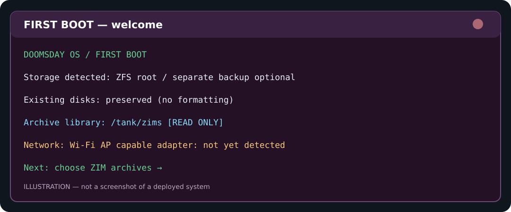
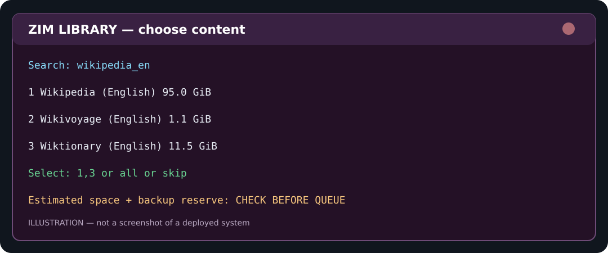
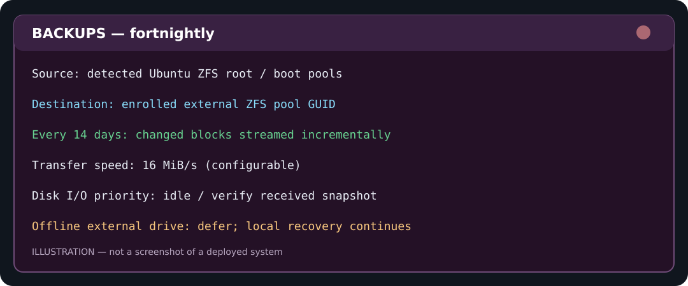

# DoomsdayOS: illustrated usage

**Prototype status:** No complete ISO or bare-metal restore has yet been proven. These images are illustrative interface examples, not verified screenshots.

## 1 — Install the first-boot kit



On an existing Ubuntu ZFS-root installation, download the ZIP to `~/Downloads`. Run each command as **one single line**:

```bash
cd ~/Downloads && unzip doomsday-firstboot-v6.zip
```

```bash
cd ~/Downloads/doomsday-firstboot-v6 && sudo bash ./install.sh
```

The installed scripts live in `/opt/doomsday-firstboot` and `/usr/local/lib/doomsday-vault`. The installer **never automatically formats any disk**. The existing system remains in use. Keep at least one independently restorable backup before installing major changes.

## 2 — Choose Wikipedia and other ZIM archives



```bash
sudo doomsday-setup
```

Choose preset `1` Full (~575 GB), `2` Partial without TED (~484 GB), or `3` Wikipedia Only (~127 GB). The wizard first checks original storage. Then choose no backup, a **folder on the OS drive**, or an existing directory on another drive. Use `exclude 13,29,33` to omit those **backup copies** while keeping the originals. If backup space is insufficient, the wizard reports the deficit and lets you exclude more numbers. Nothing downloads without a final `YES`. Existing verified ZIMs stay read-only on their own filesystem. For arbitrary ZIM selection instead of the presets, use `sudo doomsday-zims browse`.

```bash
sudo doomsday-zims status
```

A partial download is staged and should resume if the upstream server supports HTTP range requests. The verified final SHA-256 is required before publication.

## 2a — Change backups after queueing, or use two ZFS drives

After queueing, select just specific backups (e.g., ZIM **29 = Maps**, **34 = Wikipedia**) with:

```bash
sudo doomsday-zims backups
```

When a second, already imported **separate ZFS pool** is connected (not NTFS, not just a second partition on the same pool), configure optional two-drive splitting with:

```bash
sudo doomsday-zims dual-setup
sudo doomsday-zims optimize
```

The optimization shows a per-pool fit calculation and asks `APPLY PLAN`; it does not format drives or move installed archives. New downloads are assigned to the appropriate pool, and selected backups go on the *other* pool. All originals complete first, then selected backups are made to avoid overlapping backup and temporary staging peaks.

Start immediately and check status:

```bash
sudo systemctl start --no-block doomsday-zim-download.service
sudo doomsday-zims status
```

For the offline library in Ubuntu Firefox, open `http://localhost:8080`; the same Kiwix server serves completed verified ZIMs across both available drives. Start/fix it with `sudo systemctl restart doomsday-kiwix.service`. ZIM archives on a disconnected secondary drive won't be shown until the drive returns. The extracted installer directory in Downloads can be deleted after confirming installed files at `/opt/doomsday-firstboot`, but not the installed app or data folders.

## 3 — Enroll backup storage and inspect 14-day jobs



Choose an **already prepared ZFS dataset on a physically separate drive**, e.g. `tank/backups`. Its manufacturer, size and USB port do not matter.

```bash
sudo /usr/local/lib/doomsday-vault/enroll-external.sh tank/backups
```

```bash
systemctl list-timers --all 'doomsday-*.timer'
```

```bash
sudo systemctl start doomsday-stream-replica.service
```

```bash
sudo journalctl -u doomsday-stream-replica.service -n 60 --no-pager
```

First backup is a full ZFS stream; later healthy runs send changed blocks, capped by the bandwidth policy. The service runs with low I/O scheduling priority and skips when the enrolled external disk is absent. Always validate a restore to a **spare** disk before considering backups dependable.

## 4 — Check archives and portability

```bash
sudo python3 /opt/doomsday-firstboot/app/archive_guard.py verify
```

```bash
sudo /opt/doomsday-firstboot/scripts/portability-report.sh
```

```bash
sudo zpool status
```

If `tank` is absent, the system should retain its local protection but cannot restore a failed *physical* disk from copies stored on that same disk. A local ZFS scrub repairs damaged blocks only when readable redundant blocks exist.

## 5 — Build an ISO (experimental)

```bash
./build-iso.sh /path/to/ubuntu-desktop.iso /path/to/doomsday-desktop.iso
```

The ISO must be separately supplied and the resulting boot image tested in an isolated VirtualBox VM using disposable virtual disks. The build script is *not* proof of a working unattended installer. The Wi-Fi hotspot requires a compatible Wi-Fi adapter and is never forced on an active network connection.
